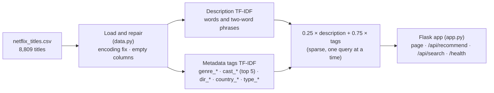
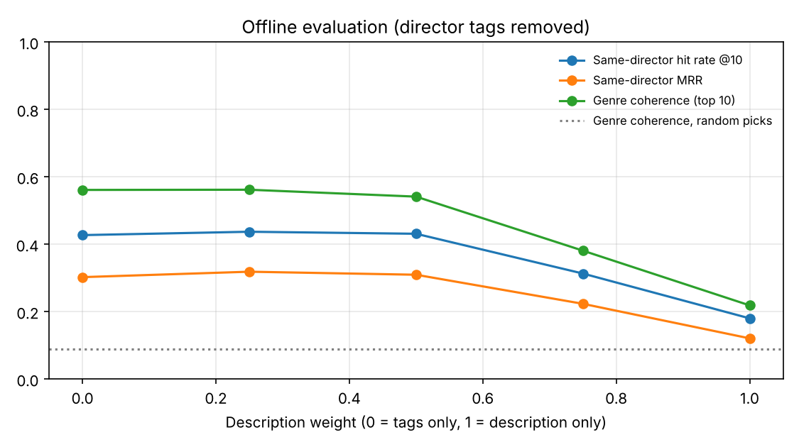

<div align="center">

# WatchNext: Netflix Movie and Series Recommender (Flask)

**A content-based recommender over 8,809 Netflix titles, served as a Flask web app and JSON API. Type a film or series you liked, or describe what you want to watch, and get similar titles with the reasons they were picked (shared genres, cast and director).**

[](https://github.com/Collinsthe4th/netflix-recommender/actions/workflows/ci.yml)
[](https://www.python.org/)
[](https://flask.palletsprojects.com/)
[](https://scikit-learn.org/)

</div>

---

## Contents

- [About the project](#about-the-project)
- [How it works](#how-it-works)
- [Tech stack](#tech-stack)
- [Evaluation](#evaluation)
- [Interactive dashboard](#interactive-dashboard)
- [Getting started](#getting-started)
- [JSON API](#json-api)
- [Project structure](#project-structure)
- [Limitations](#limitations)

## About the project

Netflix shows each viewer a few rows out of thousands of titles, so a good "more like this" list matters a lot. The Kaggle "Netflix Movies and TV Shows" dataset has no viewing history, only what each title is: type, title, director, cast, country, release year, rating, duration, genres and a short description. So I built a content-based recommender (one that compares the items themselves) and wrapped it in a small Flask app.

Before modelling, I had to fix two problems in the raw file. It has 14 empty columns at the end of every line, and one row (the cast list of the film "Serena") is saved in a different text encoding (Windows-1252) inside an otherwise UTF-8 file. A normal read crashes on that row, and a lenient read turns names such as "Bodil Jørgensen" into "Bodil J?rgensen". The loader decodes only those bytes as Windows-1252, so every row and every name is kept.

## How it works



1. **Description similarity.** TF-IDF (term frequency-inverse document frequency, a weight that is high for words that are rare across the catalogue) on each description, compared with cosine similarity.
2. **Metadata similarity.** Every genre, the first 5 cast members, the directors and the countries are turned into single tokens such as `cast_robert_de_niro`. This stops "Tom Hanks" from matching "Tom Cruise" on the shared word "Tom". The tags are also weighted with TF-IDF, so a shared niche director counts for more than a shared "Dramas" label.
3. **Blend.** The final score is 0.25 × description + 0.75 × tags. A full 8,809 × 8,809 similarity matrix would take about 600 MB of memory, so the app scores one query at a time against the sparse matrices instead. Each request takes about 5 milliseconds.

For example, "The Irishman" returns "GoodFellas", "Raging Bull" and "Mean Streets", and each card says what they share: Robert De Niro, Joe Pesci and the director Martin Scorsese.

## Tech stack

| Area | Tools |
|---|---|
| Data handling | pandas, custom codec error handler for the encoding fix |
| Model | scikit-learn `TfidfVectorizer`, sparse cosine similarity |
| Web app | Flask 3 (application factory, Jinja templates), plain CSS, a few lines of JavaScript |
| Serving | gunicorn, `render.yaml` and `Procfile` for one-click deploys |
| Testing | pytest with the Flask test client, GitHub Actions |

## Evaluation

There is no viewing data, so I used two checks that do not need it. Both ran on a fixed random sample of 1,000 query titles.

1. **Same-director retrieval.** 2,811 titles have a director who made at least one other title in the catalogue. For this check I removed the director tags from the model, so it had to find the director's other work from the plot, cast and genres alone. I report the hit rate @10 (share of titles with at least one of the director's other titles in the top 10) and the MRR (mean reciprocal rank).
2. **Genre coherence.** The average Jaccard overlap (shared genres divided by all genres of both titles) between a title and its top 10. Random picks score 0.089.

| Description weight | Director hit rate @10 | Director MRR | Genre coherence |
|---|---|---|---|
| 0.00 (tags only) | 0.427 | 0.302 | 0.561 |
| **0.25 (chosen)** | **0.437** | **0.318** | **0.562** |
| 0.50 | 0.431 | 0.309 | 0.541 |
| 0.75 | 0.313 | 0.223 | 0.381 |
| 1.00 (description only) | 0.180 | 0.121 | 0.219 |

Table 1- Offline evaluation across the description weight (director tags removed).



Fig. 1- Same-director retrieval and genre coherence as the description weight goes from 0 to 1. Source: Collins Akagha (2026).

A weight of 0.25 was the best on all three numbers, so I made it the default. I first expected the description to matter most, but it was the weakest signal on its own. Netflix descriptions are only one or two sentences long, so two titles rarely share enough words. The structured tags (cast, genres and country) carry most of the information, and a small share of description text helps to break ties between titles with similar tags. This shows that for short texts, clean metadata is worth more than a bigger text model.

## Interactive dashboard

The Streamlit app (`streamlit_app.py`) is the live demo. You can pick any of the 8,809 titles or type a description, choose movies or series only, and see what each recommendation has in common with your title. The Flask app below serves the same model with a JSON API.

```bash
streamlit run streamlit_app.py
```

## Getting started

```bash
git clone https://github.com/Collinsthe4th/netflix-recommender.git
cd netflix-recommender
python -m venv .venv && source .venv/bin/activate   # Windows: .venv\Scripts\activate
pip install -r requirements.txt && pip install -e .

flask --app netflix_rec.app run        # open http://127.0.0.1:5000
python scripts/evaluate.py             # rebuilds results/metrics.json and the figure (about 25 seconds)
python -m pytest -q
```

To deploy on [Render](https://render.com), choose "New > Blueprint" and point it at this repository. The included `render.yaml` installs the requirements and starts gunicorn.

## JSON API

| Endpoint | Example | Returns |
|---|---|---|
| `GET /api/recommend` | `?title=narcos&k=5&type=TV Show` | matched title and recommendations |
| `GET /api/recommend` | `?describe=a heist crew robs a bank` | recommendations for a description |
| `GET /api/search` | `?q=stranger` | up to 8 matching titles (autocomplete) |
| `GET /health` | | `{"status": "ok", "titles": 8809}` |

Each result has `show_id`, `title`, `type`, `release_year`, `rating`, `duration`, `genres`, `similarity`, `shared` and `description`. Unknown titles return 404 and an empty query returns 400.

## Project structure

```
netflix-recommender/
├── data/raw/netflix_titles.csv
├── src/netflix_rec/
│   ├── data.py           # loading, encoding repair, list columns
│   ├── recommender.py    # TF-IDF description + metadata tags, explanations
│   ├── app.py            # Flask factory, page, JSON API, health check
│   ├── templates/index.html
│   └── static/style.css
├── scripts/evaluate.py   # same-director retrieval, genre coherence, weight sweep
├── results/              # metrics.json and figures/
├── tests/                # model and Flask route tests
└── render.yaml · Procfile
```

## Limitations

Content-based filtering only recommends titles that look like the one you chose. It cannot learn that people who enjoy a crime drama often also enjoy a particular comedy, which collaborative filtering (learning from many users' viewing histories) would pick up. The same-director check is also only a proxy for quality, and the 0.437 hit rate means that for more than half of the titles none of the director's other work reached the top 10. Part of the reason is that many directors in the catalogue work across very different genres.

In conclusion, a blend weighted towards clean metadata tags gave the best recommendations on both checks, and the Flask app serves them in about 5 milliseconds per request without holding a full similarity matrix in memory.
